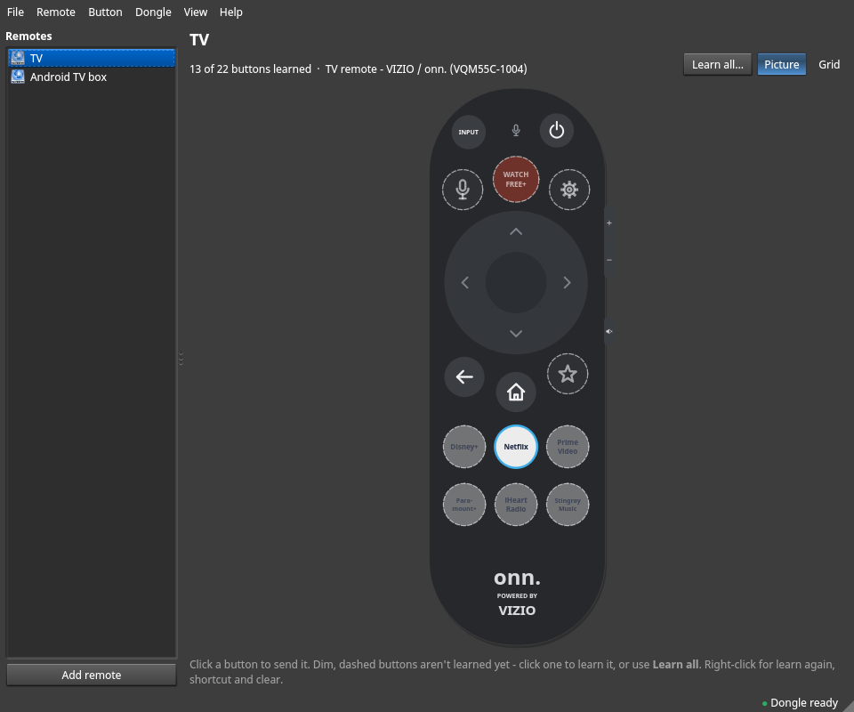
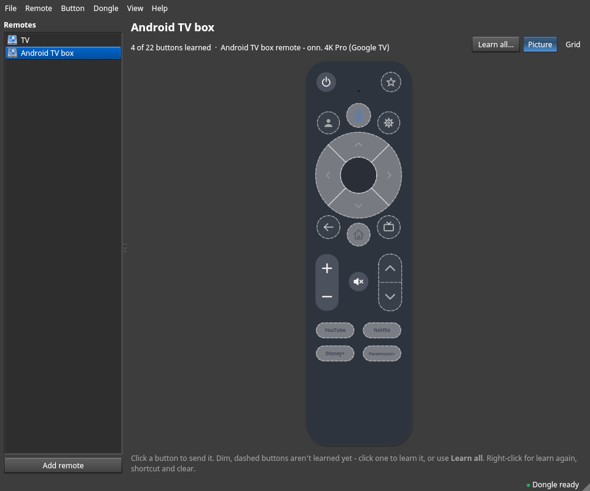
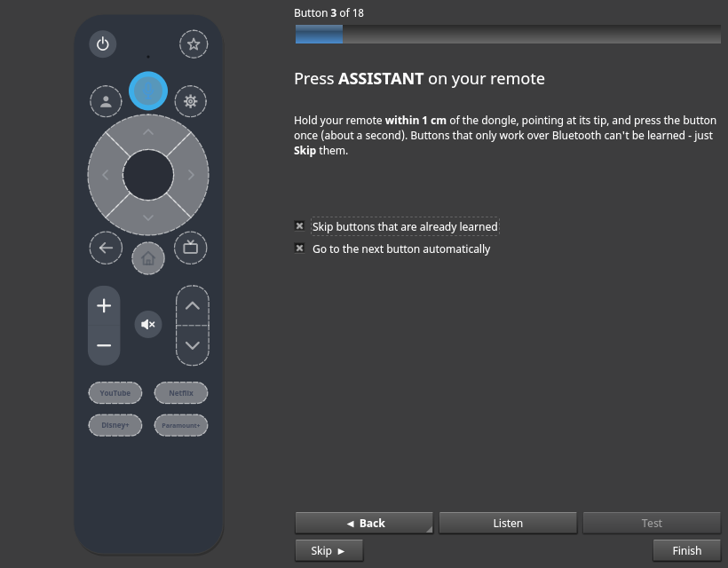

# IR Remote

**In plain words:** IR Remote turns the little USB-C infrared blaster
(ELK Smart / OCRUSTAR "Smart IR Blaster", USB ID `045c:0132`) into a remote
control on your desktop. You teach it the buttons of your real remotes (TV,
soundbar, fan, ...) once, then press them from the window, from a keyboard
shortcut, or from a script.

It is a friendly front end for **elksmart-comm**, which does the actual
talking to the dongle.

## Install

IR Remote needs two packages: **elksmart-comm** (the small program that talks
to the dongle, plus a udev rule so you can use it without `sudo`) and
**irremote** (the app). Both are on the
[Releases page](https://github.com/eugenesflanagin-spec/irremote/releases)
for each supported distribution. Download the two files for your system into
one folder, open a terminal there, and run the line for your distribution.
Your package manager installs PyQt6 and dbus-python for you.

| Distribution | Files to download | Install command |
|---|---|---|
| **Arch Linux** (and Manjaro, EndeavourOS, CachyOS) | `elksmart-comm-git-...-x86_64.pkg.tar.zst`, `irremote-...-any.pkg.tar.zst` | `sudo pacman -U ./elksmart-comm-git-*.pkg.tar.zst ./irremote-*-any.pkg.tar.zst` |
| **Debian 13** (trixie) | the two files with `.deb13` in the name | `sudo apt install ./elksmart-comm_*.deb13_amd64.deb ./irremote_*.deb13_all.deb` |
| **Ubuntu 24.04** (noble) and flavours | the two files with `.ubuntu24.04` in the name | `sudo apt install ./elksmart-comm_*.ubuntu24.04_amd64.deb ./irremote_*.ubuntu24.04_all.deb` |
| **Fedora 44** | the two files with `.fc44` in the name | `sudo dnf install ./elksmart-comm-*.fc44.x86_64.rpm ./irremote-*.fc44.noarch.rpm` |
| **openSUSE Tumbleweed** | the two files with `.tw` in the name | `sudo zypper install --allow-unsigned-rpm ./elksmart-comm-*.tw.x86_64.rpm ./irremote-*.tw.noarch.rpm` |

Notes:

* Type `./` in front of the file names: that tells the package manager to
  use the downloaded file instead of searching its online repositories.
* On Ubuntu, PyQt6 comes from the **universe** repository, which is switched
  on by default. If apt says it can't find `python3-pyqt6`, run
  `sudo add-apt-repository universe` and try again.
* openSUSE asks about the package signature because these files aren't
  signed; `--allow-unsigned-rpm` says that's fine. You can compare the files
  with `SHA256SUMS` from the same release (`sha256sum -c SHA256SUMS --ignore-missing`).
* After installing, unplug and replug the dongle once (the package also tries
  to apply the udev rule right away). The rule is
  `/usr/lib/udev/rules.d/70-elksmart-ir.rules` on every distribution.
* To remove: `sudo pacman -R irremote elksmart-comm-git`,
  `sudo apt remove irremote elksmart-comm`, `sudo dnf remove irremote elksmart-comm`
  or `sudo zypper remove irremote elksmart-comm`. Your remotes in
  `~/.config/irremote/` stay.

**Arch Linux, built from this repository** (instead of the release files):

```
cd packaging/elksmart-comm-git && makepkg -si     # the dongle tool + udev rule
cd ../.. && makepkg -si                           # IR Remote itself
```

`elksmart-comm-git` builds **elksmart-comm** from upstream and also installs the
udev rule.

**Other distributions:** install elksmart-comm (from
[usb-drivers](https://git.janouch.name/p/usb-drivers)), PyQt6 and dbus-python,
copy `packaging/elksmart-comm-git/70-elksmart-ir.rules` to
`/usr/lib/udev/rules.d/`, then run `python3 -m irremote` from this directory.

How the release packages are built and tested: see `packaging/README.md`.

Start it from the application menu (**Utilities -> IR Remote**) or run `irremote`.

## Learn your first button

1. Plug in the dongle. The bottom-right corner should say **● Dongle ready**.
2. Click the grey **Power** button on the **TV** remote (or **Learn new button**).
3. Click **Start listening**.
4. Hold your TV remote **within 1 cm** of the dongle, pointing at its tip, and
   press the button once (hold it about a second).
5. When it says **Got it!**, click **Test** - your TV should react.
   If it does, click **Save**. If not, click **Retry** and capture it again.

Then just click the button to send it.

## A picture of your remote

IR Remote can show your remote as a **picture of the real thing**: click a
button on the picture to send it, just like pressing it on the remote.



Two remotes are built in:

* **TV remote - VIZIO / onn. (VQM55C-1004)** - the onn. "Powered by VIZIO"
  voice remote. Volume Up/Down and Mute are the small buttons on its right side.
* **Android TV box remote - onn. 4K Pro (Google TV)** - the remote of the
  onn. Google TV 4K Pro streaming box (also sold as a replacement, TCNOUMT).



How to use it:

1. **Remote -> Add remote...**, give it a name and pick a picture
   (or, for a remote you already have: **Remote -> Picture...**).
2. Buttons you haven't taught IR Remote yet look **dim with a dashed outline**.
   Hover over a button to see its name and whether it's learned.
3. **Click a dim button** to learn it, or click **Learn all...** to go through
   every button in turn: the button glows on the picture and IR Remote says
   which one to press ("Press VOLUME UP on your remote"). It starts with the
   buttons most likely to work (Power, Volume, Mute, Input). **Skip** buttons
   that don't learn, **Back** to test one again, **Finish** whenever you like -
   everything you learned so far is already saved.
4. **Click a learned button** to send it. **Right-click** a button for
   **Learn again**, **Assign shortcut** and **Clear**.

**View -> Grid / Picture** (or the buttons top right) switches between the
picture and the plain grid of buttons at any time.



### Use a photo of your own remote

Have a different remote? **Add remote -> Use my own picture...** and pick a
photo of it (taken straight from the front works best). Then draw a shape
over each button: **Add round** or **Add square**, type the button's name,
drag the shape onto the button in the photo, and drag its little corner
square to make it fit. Double-click a shape to rename it, press **Delete** to
remove it. Change it later with **Remote -> Buttons on my picture...**.

Your photo is copied to `~/.config/irremote/photos/`; it stays on your
computer and isn't part of IR Remote.

### Why won't some buttons learn? (Bluetooth)

IR Remote can only learn buttons that send **infrared** light. Many modern
remotes send some or most buttons over **Bluetooth** instead, and the dongle
can't see those at all - learning them just ends with "Nothing was received".

* **The Google TV box remote** talks to the box over Bluetooth once it's
  paired - usually the D-pad, Home, Back, the app buttons and the Assistant/mic
  button. Typically only the **TV buttons (Power, Volume, Mute, Input)** are
  infrared, and those are meant for your TV, not the box. The box itself may
  need an infrared receiver to be controlled by IR at all, so learning the box's
  buttons may not work. The picture is still there for the buttons that do.
* **The VIZIO TV remote**: the **Voice** (mic) button is Bluetooth-only; the
  other buttons are normally infrared.

If a button "learns nothing" even though you held it close to the dongle,
that's most likely why: just **Skip** it.

Also: infrared needs a **clear line of sight**. When sending, the TV (its
remote sensor, usually at the bottom edge of the screen) must be **in front
of the dongle**, with nothing in between.

## Send from a keyboard shortcut

A global shortcut is already set up for the TV:

| Key            | Does                      |
|----------------|---------------------------|
| `Meta+Ctrl+P`  | TV / Power                |

(Until you have learned TV / Power it shows a notification telling you so.)

To add your own: right-click a button -> **Edit...** -> **Global shortcut**.
Shortcuts work anywhere in Plasma, even with IR Remote closed, and appear in
System Settings -> Keyboard -> Shortcuts. **View -> Shortcuts...** lists them all.
The **In-app key** field is a key that works only while the window is focused.

From the command line:

```
irremote shortcut set "Soundbar" "Volume Up" Meta+Ctrl+Up
irremote shortcut list
irremote shortcut clear "Soundbar" "Volume Up"
```

## Command line (for scripts and power users)

```
irremote send "TV" "Power"            # press a saved button (names are case-insensitive)
irremote send -r 5 "Soundbar" "Volume Up"   # press it 5 times
irremote send-code --nec 20df         # raw NEC: address 20, command df (4 hex digits per press)
irremote send-code -f 36000 <hex>     # raw learned code at 36 kHz
irremote learn                        # capture a button, print its code
irremote learn --save "Fan" "Speed"   # capture and save it
irremote list | status | reset
irremote send --dry-run "TV" "Power"  # check a button is there and learned, send nothing
irremote layouts                      # list the remote pictures (add -v for their buttons)
irremote layout "TV" vizio-onn-tv     # show the TV remote as that picture (none = grid)
irremote export ~/ir-remotes.json     # share your remotes
irremote import [--merge] file.json
```

`send` shows a desktop notification if something goes wrong (turn off with
`--no-notify`) and exits non-zero.

## Where things are kept

* Remotes: `~/.config/irremote/remotes.json` (plain JSON; File -> Import/Export to share).
  The first time IR Remote 1.1 saves over a 1.0 file it keeps the old one as
  `remotes.json.v1-backup`.
* Photos of your own remotes: `~/.config/irremote/photos/`
* Extra remote pictures (layouts) you make or get from others:
  `~/.config/irremote/layouts/*.json` (same format as the built-in ones in
  `/usr/lib/irremote/irremote/layouts/`; see `irremote/layouts.py` for the format)
* Global-shortcut launchers: `~/.local/share/applications/irremote-*.desktop`
* Window settings: `~/.config/irremote/irremote.conf`

## Troubleshooting

| What you see | What it means / what to do |
|---|---|
| **Dongle not found** | Plug it in. `lsusb` should list `045c:0132 ELKSMART Smart IR Blaster`. |
| **No permission** | The udev rule isn't applied yet: unplug and replug the dongle. Check with `getfacl /dev/bus/usb/BBB/DDD` - your user should be listed. |
| **Nothing was received** when learning | Hold the remote closer (under 1 cm), aim at the tip of the dongle, hold the button a little longer, try again. Some remotes need fresh batteries. If one particular button never learns, it probably uses Bluetooth, not infrared (see "Why won't some buttons learn?") - skip it. |
| **The dongle isn't answering** | Use **Dongle -> Reset dongle** (or `irremote reset`). If it still fails, unplug and replug it. This can happen after a cancelled learn - the dongle waits for an IR signal and ignores everything else until it gets one; IR Remote resets it automatically in that case. |
| Button "sent" but the TV doesn't react | Make sure the dongle can "see" the TV (line of sight to its sensor). Learn the button again (captures aren't always perfect), and check the frequency (38000 Hz is right for almost everything). |
| **in use by another program** | Only one program can use the dongle at once; wait a moment and retry. |
| Shortcut does nothing | Check System Settings -> Keyboard -> Shortcuts for the entry "IR Remote: TV Power". Run the command (`irremote send "TV" "Power"`) in a terminal to see the error. |

## Technical notes

* Remote pictures are vector drawings made from small JSON files (shapes,
  positions, names) - no logos or artwork; app buttons just show their names.
  Button names on a picture are the names buttons are saved under, so
  `irremote send "TV" "Volume Up"` works whichever view you use.

* Learned codes are stored exactly as elksmart-comm prints them ("Full command").
  NEC codes are stored as address+command pairs and sent with `--nec`.
* Every action holds a lock (`$XDG_RUNTIME_DIR/irremote-<uid>.lock`) so the
  window and shortcut-triggered sends don't fight over the dongle.
* The `045c:0132` dongle answers the learn command with `ff ff ff ff` before
  any IR data; stock elksmart-comm stopped there with "unexpected response".
  `packaging/elksmart-comm-git` carries a small patch that skips it.

## Credits

The dongle protocol is implemented by **elksmart-comm**, part of
[usb-drivers](https://git.janouch.name/p/usb-drivers) by
Přemysl Eric Janouch (0BSD licence; installed with the elksmart-comm package,
for example `/usr/share/licenses/elksmart-comm-git/LICENSE` on Arch,
`/usr/share/doc/elksmart-comm/copyright` on Debian/Ubuntu and
`/usr/share/licenses/elksmart-comm/LICENSE` on Fedora/openSUSE). IR Remote only runs it.

IR Remote itself is MIT licensed (see `LICENSE`). The packaging in `packaging/`
builds elksmart-comm from upstream (a pinned commit) with one small patch, and keeps its
0BSD licence in `packaging/elksmart-comm-git/LICENSE.usb-drivers`.
